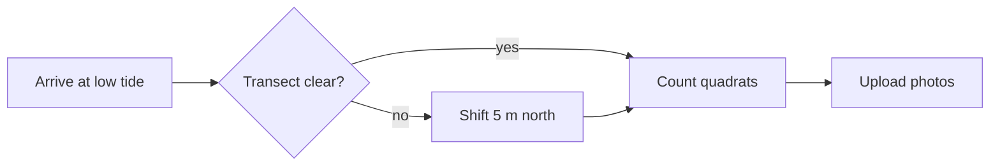

# Tidepool survey: spring 2026

> [!NOTE]
> Low tide on **May 14** was −1.4 ft at 06:52. Next window: [[schedule#June]].

## Counts by zone

| Zone | Ochre stars | Anemones | Urchins |
|---|--:|--:|--:|
| High | 2 | 41 | 0 |
| Mid | 17 | 126 | 8 |
| Low | 34 | 88 | 52 |

## Survey flow



## Density

Mean density per quadrat: $\bar{d} = \frac{1}{n}\sum_{i=1}^{n} c_i$, with $n = 24$.

```python title="density.py" {3}
import pandas as pd
counts = pd.read_csv("quadrats.csv")
density = counts.groupby("zone")["stars"].mean()
print(density.round(1))
```

## To do

- [x] Calibrate the GPS unit
- [x] Photograph every quadrat
- [ ] Send counts to ==the regional database==
- [ ] Order replacement tide boots :boot:
