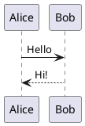

# Extra embedded formats

## GeoJSON map

```geojson
{
  "type": "FeatureCollection",
  "features": [
    { "type": "Feature", "properties": { "name": "Lighthouse" },
      "geometry": { "type": "Point", "coordinates": [-70.2071, 43.6231] } },
    { "type": "Feature", "properties": { "name": "Harbor walk" },
      "geometry": { "type": "LineString", "coordinates": [[-70.25, 43.65], [-70.24, 43.655], [-70.23, 43.652]] } }
  ]
}
```

## TopoJSON

```topojson
{
  "type": "Topology",
  "objects": { "square": { "type": "Polygon", "arcs": [[0]] } },
  "arcs": [[[0, 0], [10, 0], [10, 10], [0, 10], [0, 0]]]
}
```

## STL (3D model)

```stl
solid tetrahedron
  facet normal 0 0 -1
    outer loop
      vertex 0 0 0
      vertex 1 0 0
      vertex 0 1 0
    endloop
  endfacet
  facet normal 0 -1 0
    outer loop
      vertex 0 0 0
      vertex 0 0 1
      vertex 1 0 0
    endloop
  endfacet
  facet normal -1 0 0
    outer loop
      vertex 0 0 0
      vertex 0 1 0
      vertex 0 0 1
    endloop
  endfacet
  facet normal 1 1 1
    outer loop
      vertex 1 0 0
      vertex 0 0 1
      vertex 0 1 0
    endloop
  endfacet
endsolid tetrahedron
```

## SMILES (chemistry)

```smiles
CC(=O)OC1=CC=CC=C1C(=O)O
C1=CC=C(C=C1)O
```

## PlantUML (needs a server; see Settings)


