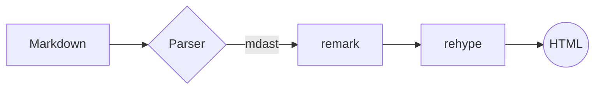
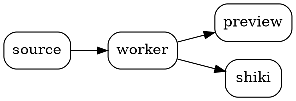

# Omnimark showcase

A tour of what the renderer supports. 

## Text

**Bold**, *italic*, ~~strikethrough~~, `inline code`, <kbd>Ctrl</kbd>+<kbd>S</kbd>,
<mark>highlighted</mark>, H<sub>2</sub>O, E = mc<sup>2</sup>, and an autolink: https://example.com.

Pandoc-style H~2~O and E = mc^2^, ==marked text==, and emoji shortcodes :rocket: :tada:.

A footnote reference[^1] and another[^note].

[^1]: The first footnote.
[^note]: A named footnote.

## Lists

- Item one
- Item two
  - Nested item
1. First
2. Second

- [x] Done task
- [ ] Open task

## Definition list

Markdown
: A lightweight markup language.

Omnimark
: A viewer and editor for it.

## Table

| Feature | Status | Notes |
|:--------|:------:|------:|
| GFM tables | ✅ | aligned |
| Math | ✅ | KaTeX |
| Diagrams | ✅ | Mermaid, Graphviz |

## Alerts

> [!NOTE]
> Useful information.

> [!TIP]
> A helpful tip.

> [!WARNING]
> Something to watch out for.

> A plain blockquote.

## Math

Inline math $e^{i\pi} + 1 = 0$ and display math:

$$
\int_{-\infty}^{\infty} e^{-x^2}\,dx = \sqrt{\pi}
$$

```math
\sum_{n=1}^{\infty} \frac{1}{n^2} = \frac{\pi^2}{6}
```

## Code

```ts title="greet.ts" {2}
export function greet(name: string): string {
  const message = `Hello, ${name}!`;
  return message;
}
```

```python
def fib(n):
    a, b = 0, 1
    for _ in range(n):
        a, b = b, a + b  # [!code highlight]
    return a
```

```diff
- removed line
+ added line
  unchanged line
```

```js noLineNumbers
console.log('no line numbers here');
```

```unknownlang
plain text fallback
```

## Diagrams





```vega-lite
{
  "$schema": "https://vega.github.io/schema/vega-lite/v5.json",
  "description": "Rendered bundle size by chunk",
  "data": {"values": [
    {"chunk": "core", "kb": 210}, {"chunk": "katex", "kb": 259},
    {"chunk": "mermaid", "kb": 640}, {"chunk": "graphviz", "kb": 813}
  ]},
  "mark": "bar",
  "encoding": {
    "x": {"field": "chunk", "type": "nominal", "sort": "-y"},
    "y": {"field": "kb", "type": "quantitative", "title": "KB"}
  }
}
```

```csv
Name,Language,Stars
unified,JavaScript,4500
shiki,TypeScript,11000
mermaid,TypeScript,78000
graphviz,C,1800
```

```abc
X:1
T:Scale
M:4/4
L:1/4
K:C
C D E F | G A B c |
```

```wavedrom
{ signal: [
  { name: "clk",  wave: "p......" },
  { name: "data", wave: "x.345x.", data: ["a", "b", "c"] },
  { name: "req",  wave: "0.1..0." }
]}
```

```nomnoml
[Markdown] -> [Worker|unified;shiki]
[Worker] -> [Preview]
[Preview] -> [<database> Cache]
```

```mermaid
this is not valid mermaid
```

## Raw HTML

<details>
<summary>Click to expand</summary>

Hidden content with **markdown** inside.

</details>

<script>alert('this must be stripped')</script>


## Links

- [Other document](other.md)
- [Jump to Math](#math)
- [External](https://example.com)
